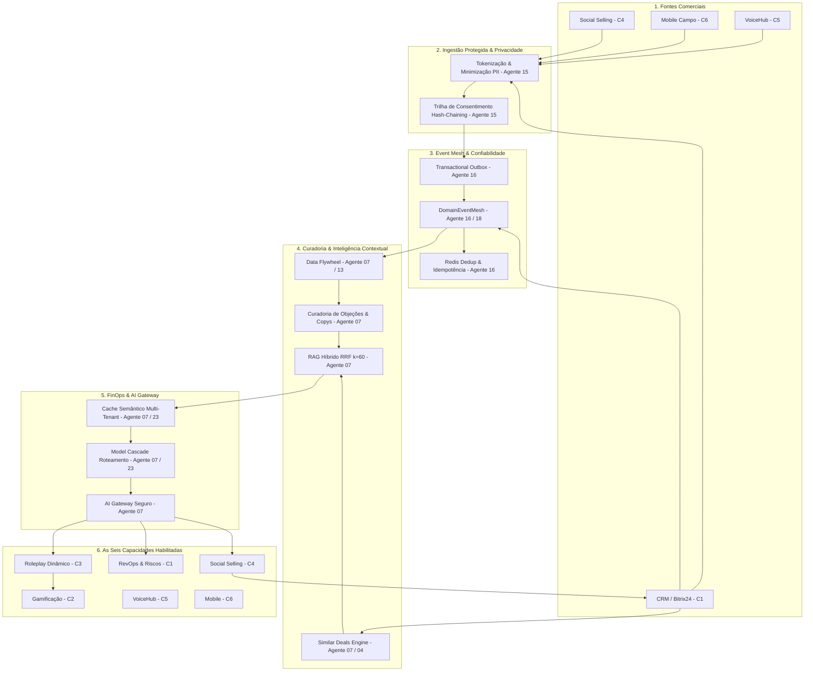

# PLANO DE EXECUÇÃO — ONDA 01: FUNDAÇÃO DA INTELIGÊNCIA AUTÔNOMA
**Projeto:** BIRTH HUB 360  
**Versão:** 1.0.0 — Data: 2026-10-18  
**Coordenador:** Agente 00  
**Auditor Independente:** Agente 24  
**Branch de Integração:** `integracao/onda-01`  

---

## 1. Visão Geral e Arquitetura Unificada

A Onda 01 estabelece a infraestrutura compartilhada de inteligência autônoma do Birth Hub 360, integrando cinco eixos tecnológicos às seis capacidades consolidadas na Onda 00 (C1-RevOps, C2-Gamificação, C3-Roleplay, C4-Social Selling, C5-VoiceHub, C6-Mobile).

### Diagrama Arquitetural de Fluxo de Dados (Mermaid)

---

## 2. Roteiro de Implementação Cirúrgica em 7 Fases

### Fase 1: Contratos Compartilhados Versionados (Agente 18 & 01)
- `src/shared/contracts/domainEventMesh.contract.ts`: Tipagem estrita de envelopes de eventos, tipos canônicos e metadados de rastreabilidade.
- `src/shared/contracts/dataFlywheel.contract.ts`: Contratos de extração de objeções, ciclo de vida de curadoria e copys vencedoras.
- `src/shared/contracts/semanticCache.contract.ts`: Interfaces para chaves compostas, TTL e políticas de isolamento multi-tenant.
- `src/shared/contracts/consentAudit.contract.ts`: Tipagem de hash chaining criptográfico e inventário de consentimento.

### Fase 2: DomainEventMesh & Resiliência Assíncrona (Agente 16 & 13)
- `src/lib/queue/domainEventMesh.service.ts`: Publicação desacoplada, outbox seguro, deduplicação em Redis por TTL e proteção contra ciclos causais.
- `src/lib/queue/domainEventMesh.queue.ts`: Fila BullMQ com Dead-Letter Queue e retries exponenciais configurados.
- Integração dos 5 fluxos canônicos de eventos (Reunião Mobile, Chamada VoiceHub, Risco Elevado, Roleplay Concluído, Abordagem Convertida).

### Fase 3: Data Flywheel & Curadoria Comercial (Agente 07, 13, 12)
- `src/features/playbook/services/curatedObjection.service.ts`: Gestão do ciclo de vida das objeções (`DETECTED` -> `NORMALIZED` -> `REVIEW_REQUIRED`/`VERIFIED` -> `PROMOTED`/`REJECTED` -> `RETRACTED`).
- Conexão nativa ao `PlaybookRoleplayAdapter` e suporte à revogação imediata.
- `src/features/intelligence/services/commercialLearningFlywheel.service.ts`: Identificação de abordagens com conversão real e alimentação de biblioteca few-shot sem fine-tuning automático.

### Fase 4: RAG Híbrido Multi-Tenant & Deals Semelhantes (Agente 07, 01)
- `src/features/knowledge/similarDeals.service.ts`: Busca de até 3 negociações ganhas do mesmo tenant com contextualização explicável.
- Enriquecimento dos guardrails contra prompt injection no RAG.

### Fase 5: FinOps, Cache Semântico & Model Cascade (Agente 07, 23)
- `src/lib/ai/cache/semanticCache.service.ts`: Armazenamento de respostas geradas com isolamento estrito por `organizationId` e hash seguro.
- `src/lib/ai/gateway/model-cascade.ts`: Classificação de complexidade (Baixa, Média, Alta) e roteamento de modelos.

### Fase 6: Privacy-Preserving AI & Consent Hash Chain (Agente 15, 21, 22)
- `src/lib/security/piiTokenizer.service.ts`: Tokenização reversível baseada em sessão com reconstituição autorizada sob demanda.
- `src/lib/security/consentAuditChain.service.ts`: Encadeamento criptográfico SHA-256 e verificação de adulteração.

### Fase 7: Testes Integrados, Validação E2E e Auditoria 24 (Agente 08 & 24)
- Suítes de testes unitários e de integração cobrindo todos os eixos.
- Gate técnico completo (`typecheck`, `lint`, `test:architecture`, `test:unit`).
- Emissão do parecer independente pelo Agente 24.
