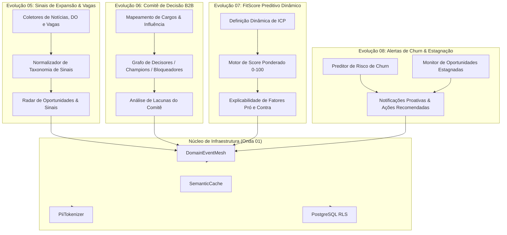

# PLANO DE EXECUÇÃO — ONDA 02: INTELIGÊNCIA COMERCIAL EXÓGENA
**Projeto:** BIRTH HUB 360  
**Versão:** 1.0.0 — Data: 2026-10-18  
**Coordenador:** Agente 00  
**Auditor Independente:** Agente 24  
**Branch de Integração:** `integracao/onda-02`  

---

## 1. Visão Geral e Arquitetura Unificada da Onda 02

A Onda 02 expande a inteligência comercial interna do Birth Hub 360 (consolidada nas Ondas 00 e 01) para capturar, analisar e agir sobre sinais de mercado externos (gatilhos exógenos), mapeamento de decisores B2B, algoritmos preditivos de FitScore e alertas inteligentes de risco de churn e estagnação em pipeline.

### Diagrama Arquitetural de Fluxo da Onda 02 (Mermaid)

---

## 2. Roteiro Cirúrgico de Execução em 5 Fases

### Fase 1: Contratos Compartilhados (Agente 18)
- `src/shared/contracts/marketSignals.contract.ts`: Interfaces de sinais externos, fontes (vagas, diários, notícias), confiança e taxonomia.
- `src/shared/contracts/decisionCommittee.contract.ts`: Tipagem de papéis do comitê (Decisor Econômico, Champion, Usuário, Bloqueador, Financeiro).
- `src/shared/contracts/fitScore.contract.ts`: Contrato de cálculo de FitScore com decomposição de atributos e explicabilidade.

### Fase 2: Evoluções 05 e 06 — Sinais e Comitê B2B (Agente 05 & 13)
- Consolidação do `src/features/market-intelligence/domain/accountSignalTaxonomy.ts`.
- Refinamento do serviço `src/features/contacts/services/decision-committee.service.ts` com cálculo de completude de comitê.
- Coletor de sinais de expansão com isolamento de tenant.

### Fase 3: Evoluções 07 e 08 — FitScore e Alertas de Receita (Agente 04 & 13)
- Otimização do `src/features/prospecting/services/enrichment/fitScore.ts` com calibração explicável.
- Automação de alertas em `src/features/analytics/services/churn-prediction.service.ts` e integração com `DomainEventMesh`.

### Fase 4: Integração com as 6 Capacidades e Event Mesh (Agente 00)
- Publicação de eventos `SIGNAL_DETECTED`, `COMMITTEE_MAPPED`, `FITSCORE_CALCULATED`, `REVENUE_RISK_DETECTED`.
- Envio de alertas de churn e sinais para o Radar e CRM.

### Fase 5: Testes Abrangentes, Verificação e Auditoria 24 (Agente 08 & 24)
- Testes unitários para cada serviço e cálculo matemático de FitScore.
- Testes de integração cross-feature comprovando persistência com RLS.
- Quality gates completos (`typecheck`, `lint`, `test:architecture`, `npm run build`).
- Auditoria e emissão do parecer pelo Agente 24.
