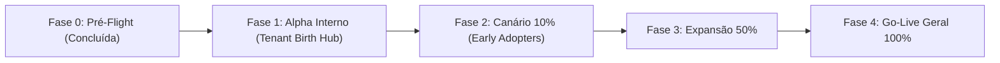

# PLANO DE IMPLANTAÇÃO E ROLLBACK (GO-LIVE CONTROLADO) — ONDA 11
## BIRTH HUB 360° — Estratégia de Liberação Progressiva, Feature Flags, Monitoramento e Rollback
**Data:** 16/10/2026  
**Responsável:** Agente 00 — Coordenador de Engenharia e Orquestração  
**Aprovação Técnica:** Agente 24 — Auditoria Independente (`.agents/reviews/24-onda-11-revisao-independente.md`)  
**Estratégia:** Rollout Canário por Tenant (0% → 10% → 50% → 100%)  

---

## 1. PRINCÍPIOS DO GO-LIVE CONTROLADO

1. **Zero Downtime:** A implantação não exige parada de banco de dados ou migrações destrutivas.
2. **Ativação Granular por Feature Flag:** Nenhuma capacidade de IA da Onda 11 é ligada globalmente sem ativação explícita de chaves no painel de administração da organização.
3. **Supervisão Humana Preservada:** Operações de fechamento, assinatura e concessão de descontos dependem obrigatoriamente de ação de usuário credenciado (**Trava B-07 / Anti-Win**).
4. **Capacidade de Rollback Instantâneo:** Desativação imediata via toggle de flag ou reversão de build em menos de 60 segundos.

---

## 2. MATRIZ DE FEATURE FLAGS (CONTROLE POR TENANT)

| Feature Flag | Descrição | Valor Default | Critério para Ativação |
| :--- | :--- | :--- | :--- |
| `FEATURE_ONDA11_CANONICAL_ENRICHMENT` | Habilita a ingestão do contrato canônico v1.0.0 e cálculo de completude/estagnação. | `false` | Tenant participante da Fase 1 (Canary). |
| `FEATURE_ONDA11_COMMERCIAL_SWARM` | Conecta os agentes BDR, SDR, CRM e Closer ao Copiloto e ferramentas avançadas. | `false` | Ativação após 48h de estabilidade do enriquecimento canônico. |
| `FEATURE_ONDA11_SSE_REALTIME_BADGES` | Habilita a escuta do evento `company-enriched` para atualização visual do Kanban sem reload. | `false` | Validada a conectividade de Redis Pub/Sub e SSE no ambiente de homologação. |
| `FEATURE_ONDA11_DEAL_HEALTH_DIAGNOSTICS` | Habilita alertas visuais de estagnação de funil e riscos de negócio no CRM. | `false` | Validação de thresholds com o time de RevOps do tenant. |

---

## 3. FASES DO ROLLOUT PROGRESSIVO



### Fase 0: Pré-Flight e Gates Locais (CONCLUÍDA)
- Typecheck (`tsc --noEmit`): 0 erros.
- Linter (`biome lint src`): 0 erros.
- Testes de Arquitetura (`npm run test:architecture`): 0 violações.
- Testes Unitários de Inteligência e CRM: 379/379 + 119/119 aprovados.
- Testes Ponta a Ponta (Cenários A a F): 6/6 aprovados.
- Build de Produção (`npm run build`): Vite + esbuild server finalizados com sucesso.
- Auditoria de Dependências e Segredos (Gitleaks): 0 vulnerabilidades críticas, 0 segredos detectados.

### Fase 1: Alpha Interno (Tenant de Staging / Organização Birth Hub)
- **Duração:** 24 horas.
- **Público:** Usuários internos e equipe de engenharia do Birth Hub 360°.
- **Ações:** Monitoramento de taxas de erro no SSE, consumo de tokens de IA e acurácia das recomendações do BDR e SDR.

### Fase 2: Canário 10% (Early Adopters Selecionados)
- **Duração:** 48 horas.
- **Público:** 3 a 5 tenants comerciais piloto selecionados pelo time de CS.
- **Gatilho de Continuidade:** Taxa de erro de API < 0.1%, latência P95 do Copiloto < 3.5s, zero relatos de inconsistência de tenant.

### Fase 3: Expansão 50%
- **Duração:** 48 horas.
- **Público:** 50% da base ativa de clientes corporativos.
- **Monitoramento:** Métricas de N+1 queries no Prisma, uso de memória do worker BullMQ e latência de entrega de mensagens Redis.

### Fase 4: Go-Live Geral (100%)
- **Habilitação definitiva:** Liberação do default `true` para as flags estáveis após 7 dias de operação sem incidentes P0/P1.

---

## 4. PLANO DE CONTINGÊNCIA E PROTOCOLO DE ROLLBACK

### 4.1 Gatilhos de Rollback Imediato (Critérios de Aborto)
A equipe de SRE e o Agente 00 devem abortar o rollout caso ocorra:
1. **Qualquer vazamento de dados cross-tenant (Violação P0 de Tenancy).**
2. **Violação da Trava B-07:** Qualquer agente tentando alterar status de negócio ou assinar documento sem confirmação humana.
3. Taxa de erro em requisições de CRM superior a **1%**.
4. Degradação de latência P95 do banco PostgreSQL superior a **500ms**.
5. Estouro orçamentário de tokens de IA acima de 150% do limite diário provisionado.

### 4.2 Procedimento Operacional de Rollback

#### Nível 1: Desativação Instantânea por Feature Flag (Tempo de Resposta: < 30 segundos)
- No painel de configuração de variáveis ou Redis:
  ```bash
  # Desativação imediata de todo o swarm comercial sem reiniciar servidores
  npm run feature-flag:set FEATURE_ONDA11_COMMERCIAL_SWARM false --all-tenants
  npm run feature-flag:set FEATURE_ONDA11_CANONICAL_ENRICHMENT false --all-tenants
  ```
- **Impacto:** O CRM continua operando normalmente na versão clássica, e o Copiloto desativa apenas as ferramentas comerciais avançadas, retornando ao modo padrão.

#### Nível 2: Reversão Completa de Build (Tempo de Resposta: < 3 minutos)
- Caso seja identificada falha estrutural no servidor HTTP ou no worker:
  ```bash
  # Reversão do deploy para a tag anterior homologada
  git checkout tags/v2.10.4-onda10-homologada
  npm run build
  systemctl restart birthhub-server
  ```

---

## 5. COMUNICAÇÃO E SUPORTE PÓS-GO-LIVE

- **Canal de Incidentes:** Sala de guerra `#incident-war-room-onda11` com monitoramento ativo do Agente 10 (SRE/Observabilidade) e Agente 00 (Coordenador).
- **Relatório de Estabilidade Pós-Lançamento:** O Agente 24 emitirá parecer de estabilidade 72 horas após a conclusão da Fase 2.
