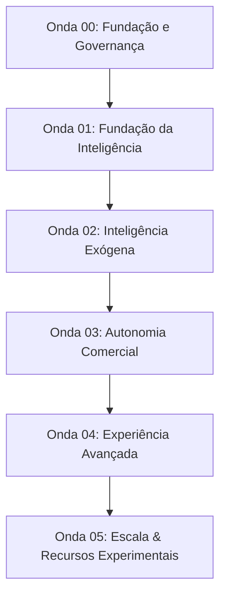

# MATRIZ DE DEPENDÊNCIAS DAS PRÓXIMAS ONDAS (ONDAS 01 A 05) — ONDA 00
**Projeto:** Birth Hub 360° / Birthub 360  
**Onda:** `00 — Fundação e Preparação`  
**Data:** 2026-10-18  
**Autoridade:** `AGENTS.md`  
**Coordenador:** Agente 00 — Chief Commercial Intelligence Engineering Orchestrator  
**Auditor Independente:** Agente 24 — Revisão Independente  

---

## 1. Visão Geral das 20 Evoluções Estratégicas

A transição da plataforma para suportar as 20 evoluções comerciais divide-se em cinco ondas temáticas ordenadas de forma sequencial, onde cada onda aproveita estritamente a fundação consolidada na Onda 00 sem introduzir débito técnico ou complexidade especulativa.

---

## 2. Detalhamento por Onda

### ONDA 01 — Fundação da Inteligência
- **Tema:** Consolidação da Memória Comercial Corporativa e Desacoplamento de Eventos.
- **Evoluções Atribuídas (4 evoluções):**
  1. *Evolução 01:* Pipeline de Curadoria do Playbook Vivo (implementação do Ajuste 1 com aprovação de gestor).
  2. *Evolução 02:* Motor Causal de Atribuição de Resultados Comerciais (implementação do Ajuste 2).
  3. *Evolução 03:* RAG Multi-Tenant com RBAC no Nível de Chunk e Provedor pgvector (Ajuste 3).
  4. *Evolução 04:* Transactional Outbox no PostgreSQL (`DomainEventOutbox`) para eventos de vendas (Ajuste 4).
- **Especialistas Ativos:** Agente 01 (Dados/Prisma), Agente 07 (IA/Automações), Agente 18 (Contratos/API).
- **Pré-Requisitos e Migrações:** Migration no Prisma para tabela `PlaybookCuratedProposal` e `DomainEventOutbox`.
- **Gates Obrigatórios:** `typecheck`, `lint`, `test:architecture`, `verify:ai`, `verify:openapi-drift`.

### ONDA 02 — Inteligência Comercial Exógena
- **Tema:** Sinais Externos, Gatilhos de Mercado e Prospecção Contextual.
- **Evoluções Atribuídas (4 evoluções):**
  5. *Evolução 05:* Rastreador de Sinais de Expansão e Contratação de Empresas-Alvo (Notícias, Diários Oficiais, Vagas).
  6. *Evolução 06:* Mapeamento Automático do Comitê de Decisão e Grafo de Influenciadores B2B.
  7. *Evolução 07:* FitScore Preditivo Baseado em ICP Dinâmico e Machine Learning Leve.
  8. *Evolução 08:* Alertas Automatizados de Risco de Churn e Oportunidades Estagnadas (RevOps C1 avançado).
- **Especialistas Ativos:** Agente 04 (CRM/BI), Agente 05 (Prospecção), Agente 13 (Enxame de Agentes).
- **Pré-Requisitos:** Provedores de enriquecimento em cascata com cache Redis ativo.
- **Gates Obrigatórios:** Testes de rate limit de API externa, validação de PII Guard e Token Quota.

### ONDA 03 — Autonomia Comercial
- **Tema:** Agentes Autônomos Supervisionados e Execução Multicanal Confiável.
- **Evoluções Atribuídas (4 evoluções):**
  9. *Evolução 09:* SDR Autônomo com Discagem Ativa por Voz e Agendamento no Google Calendar.
  10. *Evolução 10:* Cadência Multicanal Adaptativa (E-mail, WhatsApp e Voz) com Opt-Out Unificado.
  11. *Evolução 11:* Rascunho Automático de Propostas Comerciais e Integração com Assinatura Digital.
  12. *Evolução 12:* Painel de SLO e Trava de Limites de Autonomia de Agentes (Ajuste 5 - Human-in-the-loop).
- **Especialistas Ativos:** Agente 12 (Voz/Telefonia), Agente 17 (Cadência/Ciclo de Receita), Agente 15 (Segurança/LGPD).
- **Pré-Requisitos:** Trava legal de consentimento (`consentAuditChain.service.ts`) e supressão de opt-out (HTTP 409).
- **Gates Obrigatórios:** Prova de discagem SDR em horário permitido, bloqueio cross-channel em opt-out.

### ONDA 04 — Experiência Avançada
- **Tema:** Cockpit Unificado, Interface de Vendas Mobile e UX de Alta Fidedignidade.
- **Evoluções Atribuídas (4 evoluções):**
  13. *Evolução 13:* Field Meeting Recorder Mobile (C6) com transcrição local acelerada e sincronização resiliente.
  14. *Evolução 14:* Assistente de Voz do Vendedor em Tempo Real com WebSocket e Latência < 500ms.
  15. *Evolução 15:* Design System Birth Hub Impeccable (Refinamento de Cards, Aurora Neon e Feedback Tátil).
  16. *Evolução 16:* Cockpit de Gamificação 3D com Leaderboards Dinâmicos e Conquistas (C2).
- **Especialistas Ativos:** Agente 02 (Produto/UX), Agente 03 (Design/A11y), Agente 09 (Mobile).
- **Pré-Requisitos:** Testes de acessibilidade WCAG 2.2 AA e bundle size dentro do teto (< 3.14 MB).
- **Gates Obrigatórios:** `check:bundle-budget`, `npm run build`, verificação Android Capacitor.

### ONDA 05 — Escala, Governança e Recursos Experimentais
- **Tema:** Resiliência de Infraestrutura, FinOps e Simulações de Alta Complexidade.
- **Evoluções Atribuídas (4 evoluções):**
  17. *Evolução 17:* Simulador de Roleplay Multimodal com Personas Hiper-Realistas e Avaliação SPIN (C3).
  18. *Evolução 18:* Reconciliação Financeira Preditiva e Forecast Automatizado com Snapshots Semanais.
  19. *Evolução 19:* Arquitetura Multi-Região com Failover de Workers e Cache Distribuído.
  20. *Evolução 20:* Auditoria Automatizada Contínua de Segurança, ZAP, Trivy e SBOM Reproduzível.
- **Especialistas Ativos:** Agente 08 (QA/Release), Agente 10 (Infra/SRE), Agente 16 (Runtime/Escala), Agente 23 (FinOps).
- **Pré-Requisitos:** Testes de carga K6 e simulações de drill de backup/restore aprovadas.
- **Gates Obrigatórios:** `security:audit-waivers`, `security:sbom`, aprovação final de release pelo Agente 24.
