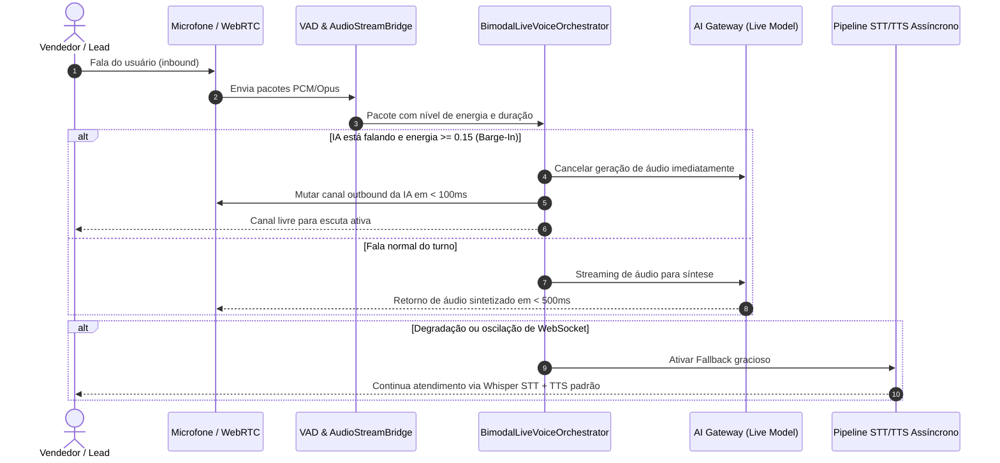

# ARQUITETURA DO STREAMING BIDIRECIONAL — BIMODAL LIVE (EIXO 5)
**Data:** 18 de Outubro de 2026  
**Especialistas:** Agente 12 (Voz e Telefonia) & Agente 07 (IA e Automações)  
**Status:** HOMOLOGADO  

---

## 1. Visão Geral

O Eixo 5 implementa comunicação de áudio bidirecional em tempo real com processamento subsegundo, turnos conversacionais fluidos, detecção de atividade de voz (VAD), interrupção imediata da resposta da IA (barge-in) e fallback automático para pipelines assíncronos STT/TTS convencionais.

---

## 2. Diagrama de Fluxo e Topologia

---

## 3. Componentes Implementados

1. **`BimodalLiveVoiceService` (`src/features/ai-voice/server/bimodalLiveVoice.service.ts`):**
   - Criação de sessões isoladas por `organizationId`.
   - Gerenciamento de turnos e barge-in em tempo real com cancelamento de geração.
   - Publicação de telemetria no `domainEventMesh`.
2. **`BimodalLiveOrchestratorService` (`src/features/voice/services/bimodalLiveOrchestrator.service.ts`):**
   - Controle de VAD, cálculo dinâmico de latências p50, p95 e p99.
   - Ativação de fallback mantendo o contexto da conversa.
3. **`bimodalLive.contract.ts` & `bimodalLiveVoice.contract.ts` (`src/shared/contracts/`):**
   - Tipagem contratual estrita para pacotes de áudio, métricas e eventos.
