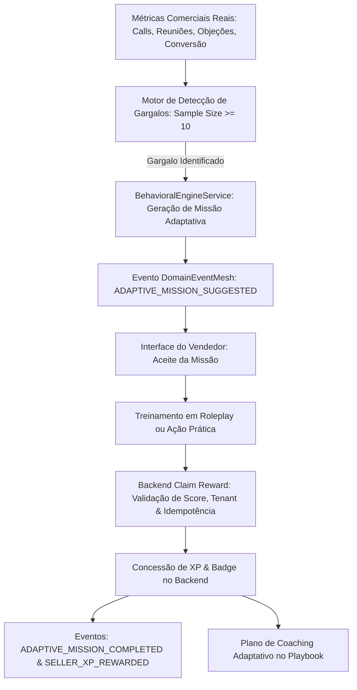

# ONDA 03 — ARQUITETURA DO BEHAVIORAL ENGINE
**Eixo 4: Gamificação Adaptativa Baseada em Gargalos Comerciais Reais**  
**Responsáveis:** Agentes 04 (CRM/BI), 07 (IA/Automações), 05 (Prospecção) e 13 (Swarm Autônomo)  
**Coordenação:** Agente 00  
**Data:** Outubro de 2026  

---

## 1. Visão Geral e Princípio Operacional
O **Behavioral Engine** transforma o sistema de gamificação do Birth Hub 360 de uma mecânica estática de pontuação em um motor de desenvolvimento contínuo de hábitos comerciais. Ele atua analisando métricas reais de desempenho e identificando **gargalos operacionais comprovados** (com amostragem estatisticamente relevante), gerando **missões adaptativas personalizadas** que se conectam diretamente ao módulo de **Roleplay** pedagógico e Playbooks comerciais.

### Regras Centrais:
1. **Dados Reais e Amostragem Mínima:** Nenhum gargalo é diagnosticado com menos de 10 atividades registradas (`SAMPLE_SIZE_INSUFFICIENT`).
2. **Recompensa Exclusiva pelo Backend:** A interface jamais concede pontos, XP ou insígnias. A concessão exige evidência criptográfica (SHA-256), verificação de tenant e regras de idempotência.
3. **Sem Inferências Pessoais:** O sistema restringe-se a métricas objetivas de conversão e técnica de vendas, sem emitir pareceres psicológicos ou perfis pessoais.

---

## 2. Fluxo Arquitetural

---

## 3. Contratos e Entidades
O motor é regido pelo contrato canônico `src/shared/contracts/behavioralEngine.contract.ts`:

- **CommercialBottleneck:** Tipo de métrica (`cold_call_conversion`, `price_objection_handling`, `qualification_depth`, `lead_recovery_rate`, `cycle_velocity`), severidade, benchmark de referência e impacto estimado.
- **AdaptiveMission:** Identificador único, tenant, vendedor, indicador de origem, meta verificável, prazo (dias), recompensa (XP e Badge), status (`SUGGESTED`, `ACCEPTED`, `IN_PROGRESS`, `COMPLETED`, `EXPIRED`, `CANCELLED`).
- **RewardClaimResult:** Status da concessão, XP concedido, insígnia persistida, nível do vendedor e hash de idempotência.
- **AdaptiveCoachingPlan:** Plano de ação complementar recomendando módulos de Roleplay, scripts de Playbook e técnicas de qualificação.

---

## 4. Idempotência e Segurança Multi-Tenant
- Cada concessão de recompensa gera um hash de evidência baseado em:
  `SHA-256(organizationId:sellerId:missionId:evidencePayload)`
- Se a mesma evidência ou conclusão for reprocessada, a recompensa anterior é retornada com `idempotencyApplied: true` sem incremento duplicado de XP ou atribuição indevida de badges.
- Todas as operações validam `organizationId` obrigatório em tempo de execução, impedindo qualquer vazamento de dados entre empresas.

---

## 5. Integração com o EventMesh
O motor publica e consome eventos padronizados no `DomainEventMesh`:
- `COMMERCIAL_BOTTLENECK_DETECTED` (versão 1.0.0)
- `ADAPTIVE_MISSION_SUGGESTED` (versão 1.0.0)
- `ADAPTIVE_MISSION_COMPLETED` (versão 1.0.0)
- `SELLER_XP_REWARDED` (versão 1.0.0)

Todos os eventos contêm `correlationId`, `organizationId` e timestamps auditáveis.
