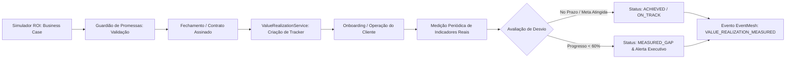

# ONDA 03 — MODELO DE VALUE REALIZATION PÓS-VENDA
**Eixo 17: Continuidade Entre Promessa Comercial e Valor Efetivamente Entregue**  
**Responsáveis:** Agentes 04 (CRM/BI), 07 (IA), 17 (Receita) e 23 (FinOps)  
**Coordenação:** Agente 00  
**Data:** Outubro de 2026  

---

## 1. Visão Geral e Princípio de Continuidade
O **Value Realization Engine** assegura que os compromissos econômicos assumidos pelo time de vendas durante a negociação (originados no Simulador de ROI e aprovados no Guardião de Promessas da Onda 02) não se percam no fechamento do contrato, sendo acompanhados continuamente durante o onboarding e a operação real do cliente.

---

## 2. Tipos de Indicadores Monitorados
1. `operational_time_reduction`: Redução de horas gastas em tarefas manuais (ex.: despacho de cargas, cadastro de motoristas).
2. `productivity_gain`: Incremento percentual de entregas, prospecções ou atendimentos por colaborador.
3. `cost_reduction`: Queda de despesas com horas extras, combustível ou multas de SLA.
4. `conversion_rate_increase`: Melhora percentual na taxa de fechamento de negócios.
5. `response_time_improvement`: Queda no tempo de primeiro contato (Speed-to-Lead).

---

## 3. Lógica Direcional de Avaliação (Redução vs. Aumento)

Para métricas de **Redução** ($\text{targetValue} < \text{baselineValue}$, ex: tempo de 60 para 15 min):
- Meta cumprida se $\text{observedValue} \le \text{targetValue} \implies \text{ACHIEVED}$.
- Progresso relativo:
  $$\text{Progresso} = \frac{\text{baselineValue} - \text{observedValue}}{\text{baselineValue} - \text{targetValue}}$$
- Se $\text{Progresso} < 0.60 \implies \text{MEASURED\_GAP}$.

Para métricas de **Aumento** ($\text{targetValue} > \text{baselineValue}$, ex: produtividade de 50% para 100%):
- Meta cumprida se $\text{observedValue} \ge \text{targetValue} \implies \text{ACHIEVED}$.
- Progresso relativo:
  $$\text{Progresso} = \frac{\text{observedValue} - \text{baselineValue}}{\text{targetValue} - \text{baselineValue}}$$
- Se $\text{Progresso} < 0.60 \implies \text{MEASURED\_GAP}$.

---

## 4. Sumário Executivo de Valor por Tenant
O serviço consolida indicadores executivos para a liderança comercial e CS:
- `totalTrackers`: Contagem global de promessas monitoradas.
- `achievedCount`: Metas comprovadamente batidas com evidência de campo.
- `onTrackCount`: Indicadores com progresso igual ou superior a 60% da janela.
- `gapCount`: Compromissos sob risco com divergência registrada.
- `averageAchievementRatePercent`: Média percentual ponderada de realização do tenant.
