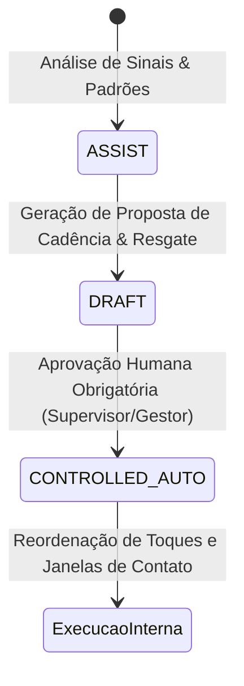

# ONDA 03 — ARQUITETURA DO SELF-DRIVING CRM
**Eixo 7: Cadências Comerciais Adaptativas e Resgate Inteligente de Leads**  
**Responsáveis:** Agentes 17 (Cadência/Ciclo de Receita), 04 (CRM/BI), 05 (Prospecção), 07 (IA) e 13 (Swarm)  
**Coordenação:** Agente 00  
**Data:** Outubro de 2026  

---

## 1. Visão Geral
O **Self-Driving CRM** capacita a plataforma Birth Hub 360 a interpretar sinais multicanais verificáveis de engajamento e reagir dinamicamente, ajustando cadências e identificando oportunidades de resgate de leads estagnados, mantendo sempre a supervisão humana sobre contatos e respeitando estritamente o consentimento do titular (Art. 18 LGPD).

### Princípios Inegociáveis:
1. **Sem Disparos Externos Automáticos Não-Autorizados:** O sistema não realiza contatos em massa nem dispara mensagens a esmo. Opera prioritariamente nos níveis `ASSIST` (recomendar) e `DRAFT` (preparar tarefas/rascunhos).
2. **Sinais Auditáveis:** Apenas sinais comprovados são considerados (ligações atendidas/não atendidas, respostas em WhatsApp/e-mail, reuniões agendadas). Visualizações genéricas de perfil ou aberturas incertas de e-mail não são tratadas como intenção inequívoca de compra.
3. **Trava Férrea de Opt-Out:** Leads que exerceram direito de oposição/opt-out têm contatos bloqueados em nível de aplicação e repositório.

---

## 2. Níveis de Autonomia do CRM

- **Nível 1 — ASSIST:** O motor detecta desvios de canal e estagnação, apresentando diagnósticos no CRM.
- **Nível 2 — DRAFT:** Cria rascunhos de abordagem, sugere migração de canais e agenda tarefas na esteira do vendedor, aguardando aprovação.
- **Nível 3 — CONTROLLED_AUTO:** Mediante política pré-aprovada pelo tenant, altera internamente as prioridades de toques para o canal mais responsivo, sem contatos externos não-autorizados.

---

## 3. Motor de Resgate de Leads Estagnados
- **Critério de Inatividade:** Leads em estágios abertos (`Prospecção`, `Qualificação`, `Apresentação`, etc.) sem qualquer atividade ou avanço há mais de 15 dias (configurável pelo tenant).
- **Filtros de Segurança:**
  - Se o lead estiver marcado como Ganho ou Perdido definitivo: **ignorado**.
  - Se o lead possuir registro de opt-out: **bloqueado categoricamente** (`eligibleForReactivation = false`, `ineligibilityReason = "Lead com opt-out formal registrado"`).
- **Estratégias de Resgate Sugeridas:**
  - `diagnostic_refresh`: Abordagem consultiva com atualização do diagnóstico econômico.
  - `consultative_breakup`: E-mail cordial de encerramento temporário de contato.
  - `multidecision_stakeholder`: Identificação de co-decisores no organograma corporativo.

---

## 4. Governança Multi-Tenant e Auditoria
- Todas as recomendações de cadência e registros de estagnação são estritamente particionados por `organizationId`.
- A aprovação de uma recomendação exige `approvedBy` documentado e publica o evento `CADENCE_CHANGE_APPROVED` no `DomainEventMesh`.
