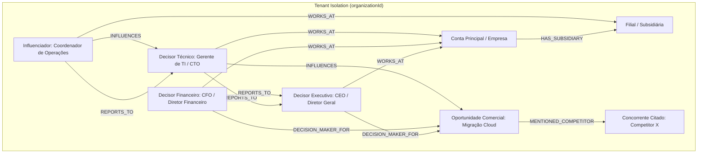

# DIAGRAMA DO GRAFO SEMÂNTICO DE CONTAS E DECISORES — ONDA 02
**Projeto:** Birth Hub 360°  
**Eixo:** 6 — Knowledge Graph & Multi-Threading Social Selling  
**Data:** 2026-10-18  

---

## 1. Diagrama Arquitetural de Nós e Relacionamentos (Mermaid)

---

## 2. Multi-Threading para Social Selling (C4)

O Knowledge Graph expõe o método `getSocialSellingMultiThreadingContext(organizationId, accountId)`, que compõe abordagens sob medida para cada decisor:

| Perfil de Decisor | Foco da Abordagem | Tópicos Prioritários |
|---|---|---|
| **Decisor Técnico** | Arquitetura, segurança, integração | APIs REST, isolamento de dados, conformidade LGPD, SLA |
| **Decisor Financeiro** | Retorno sobre investimento, TCO, CAPEX/OPEX | Payback em meses, previsibilidade de custos, redução de desperdício |
| **Decisor Executivo** | Alinhamento estratégico e produtividade | Aceleração de crescimento, diferencial competitivo, governança |
| **Influenciador** | Usabilidade e rotina diária | Facilidade de adoção, automação de tarefas manuais, suporte humanizado |

Todas as abordagens são sugestões consultivas para o vendedor humano, respeitando a proibição de disparos autônomos não autorizados.
