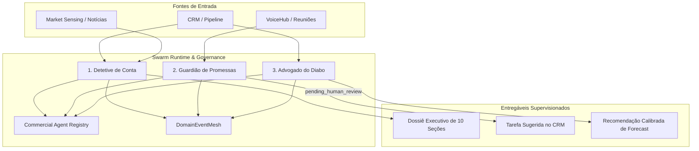

# ARQUITETURA DO SWARM TÁTICO DE APOIO COMERCIAL — ONDA 02
**Projeto:** Birth Hub 360°  
**Eixo:** 11 — Multi-Agent Tactical Swarm  
**Contrato:** `src/shared/contracts/tacticalSwarm.contract.ts`  
**Registro Canônico:** `src/features/intelligence/agents/commercialAgentRegistry.ts`  

---

## 1. Visão Geral das Três Competências Táticas

O Swarm Tático foi desenhado para atuar como uma rede de apoio ao vendedor, com regras estritas de governança:
- **Nenhum envio autônomo não autorizado**: todas as tarefas de CRM, e-mails ou mensagens permanecem no estado `pending_human_review`.
- **Zero alucinação factual**: diferenciação explícita entre fatos verificados e hipóteses de dor.
- **Isolamento de tenant (`organizationId`)** em todas as invocações.

---

## 2. Detalhamento dos Agentes

### 2.1. Detetive de Conta (Account Detective)
- **Implementação:** `src/features/intelligence/agents/tactical/accountDetective.agent.ts`
- **Gatilhos:** Nova oportunidade qualificada, reunião agendada, solicitação manual de pesquisa.
- **Estrutura do Dossiê:**
  1. Identificação da Empresa.
  2. Resumo Executivo.
  3. Fatos Verificados e Dados Firmográficos.
  4. Sinais Recentes de Mercado.
  5. Riscos Comerciais Identificados.
  6. Oportunidades Potenciais de Expansão.
  7. Comitê Decisório Mapeado (Decisores, Champions, Bloqueadores).
  8. Hipóteses Fundamentadas de Dor (com tag explícita `isHypothesisOnly: true`).
  9. Perguntas Recomendadas para Descoberta.
  10. Proveniência das Fontes, Datas e Grau de Confiança.

### 2.2. Guardião de Promessas (Promise Guardian)
- **Implementação:** `src/features/intelligence/agents/tactical/promiseGuardian.agent.ts`
- **Gatilhos:** Processamento de transcrições de reuniões e chamadas do VoiceHub/Mobile.
- **Pipeline:** Transcrição -> Detecção de Expressões de Compromisso -> Extração de Responsável e Prazo -> Status `pending_human_review` -> Aprovação pelo Gestor -> Criação de Tarefa no CRM -> Evento `PROMISE_COMMITMENT_DETECTED`.

### 2.3. Advogado do Diabo (Devil's Advocate)
- **Implementação:** `src/features/intelligence/agents/tactical/devilsAdvocate.agent.ts`
- **Gatilhos:** Oportunidades em etapas avançadas com probabilidade inflada, fechamento iminente de trimestre.
- **Critérios de Risco:**
  - Estagnação em etapa (> 20 dias sem avanço).
  - Ausência de interação recente (> 10 dias sem contato).
  - Objeções críticas não resolvidas no histórico.
  - Ameaças concorrenciais ativas.
- **Saída:** Diagnóstico de viés de otimismo (`optimismBiasDetected`), explicabilidade dos riscos e recomendação calibrada (`downgrade_probability`, `delay_close_date`, `flag_as_at_risk`).
